# Scratch-Cell 预处理 Agent — deepagents 架构 (中文版)

> 基于 `deepagents` (LangGraph) 多 Agent 架构的完整 Mermaid 流程图

```mermaid
flowchart TB
    subgraph CLI["命令行入口"]
        A["scruticell preprocess GSE_ID"]
    end

    subgraph AgentCreation["Agent 创建 (agent.py)"]
        B["create_preprocessing_agent()"]
        B --> B1["ChatOpenAI(model=deepseek-chat, temp=0.0)"]
        B --> B2["create_deep_agent()"]
        B --> B3["子 Agent: file-prep + classifier (+ evidence)"]
        B --> B4["工具: organize_output"]
        B --> B5["后端: StateBackend"]
        B --> B6["系统 Prompt: MAIN_AGENT_SYSTEM_PROMPT"]
    end

    subgraph MainAgent["主编排 Agent (Main Orchestrator)"]
        C["任务: 预处理 GEO 数据集 GSE_ID"]
        C --> C1{{"检查 FileContextReport"}}
        C1 --> C2{{"信号是否一致?"}}
        C2 -->|"一致"| C3["委托 classifier 子 Agent"]
        C2 -->|"冲突"| C4["委托 evidence 子 Agent"]
        C4 --> C5["委托 classifier 子 Agent"]
        C3 --> C6["委托 classifier 子 Agent"]
        C5 --> C6
        C6 --> C7["调用 organize_output 工具"]
        C7 --> C8["返回结果"]
    end

    subgraph FilePrep["文件准备子 Agent (file_prep.py)"]
        D["系统 Prompt: FILE_PREP_SYSTEM_PROMPT"]
        D --> D1["工具: download_gse(gse_id)\n从 NCBI GEO 下载 SOFT + 补充文件"]
        D1 --> D2["工具: decompress_files(download_dir)\n递归解压 .tar.gz / .zip 嵌套归档"]
        D2 --> D3["工具: inspect_files(download_dir, soft_file)\n检查所有文件 → 紧凑 FileContextReport"]
    end

    subgraph InspectFiles["inspect_files() 内部流程 (inspect_tool.py)"]
        E["遍历 download_dir (rglob 递归扫描)"]
        E --> E1["解析 SOFT 文件"]
        E1 --> E1a["gse_metadata → gse_info\n(标题/物种/实验类型/摘要/设计)"]
        E1 --> E1b["gsm_entries → raw_gsm\n(每条 GSM 的原始字段字典)"]
        E1 --> E1c["extract_gsm_metadata() → characteristics 键值对映射"]

        E --> E2["对每个文件: Inspector.inspect_file()"]
        E2 --> E2a["FileSummary\n(行列数/列名/数据预览/条形码格式/特征类型)"]
        E2 --> E2b{"L5: 是否为噪声文件?\n(.pdf/.docx/.png/.tar.gz/...)"}
        E2b -->|"是"| E2c["跳过信号收集，保留原始摘要"]
        E2b -->|"否"| E2d["构建 FileSignals 对象"]

        E2d --> E2d1["extract_metadata_signals()\n(molecule/strategy/title/关键词匹配)"]
        E2d --> E2d2["extract_filename_signals()\n(伴随文件检测/10x 三件套/文件名关键词)"]
        E2d --> E2d3["extract_content_signals()\n(特征ID类型/条形码格式/列名模式)"]
        E2d1 --> E2e["FileSignals\n(ancestry, file_type, metadata, filename, content)"]

        E2e --> E3["L1: build_field_value_maps()\n(字段级去重: 字段名→distinct值→GSM ID列表)"]
        E3 --> E3a["FieldValueMap\n(每个字段的独特值及覆盖的GSM)"]

        E2e --> E4["L2+L3: group_file_signals()\n(按信号指纹合并相同文件)"]
        E4 --> E4a["signal_fingerprint() = \nfile_type|feature_id_type|barcode_format|keywords\n相同指纹 → 同一组"]
        E4a --> E4b["per_file_gsm_id\n(从 ancestry 路径提取 GSM ID，不做推断)"]
        E4b --> E4c["ancestry_pattern\n({GSM}/barcodes.tsv.gz 模板)"]

        E4c --> E5["对每组: build_content_preview()\n(抽取代表文件的实际数据样本)"]
        E5 --> E5a["FileContentPreview\n(列名/特征ID样本/条形码样本/原始文本行)"]

        E4c --> E6["对每组: build_file_meta()\n(构建深度文件元数据肖像)"]
        E6 --> E6a["FileMeta\n(文件名语义token/列头语义/条形码前缀分析)"]

        E6a --> E7["对每组: compute_attribution()\n(纯信号收集，不做判决)"]
        E7 --> E7a["L0: ancestry 路径提取 GSM ID\n(re.search GSM\\d+)"]
        E7 --> E7b["L1: SOFT supplementary_file_N 精确匹配\n(文件名对照 SOFT 引用)"]
        E7 --> E7c["Signals: 提取所有 token 信号\n(filename_sample_ids/column_donor_ids/\nprefix_sample_ids...)"]
        E7a --> E7d["AttributionResult\n(candidates + signals + source)"]
    end

    subgraph MetadataExtraction["元数据提取 (inspect_tool.py 内联执行)"]
        F["build_extraction_context(raw_gsm, gse_info)"]
        F --> F1["_serialize_gsm_entries()\n(所有 SOFT 字段值 → 纯字符串: list→分号分隔, None→空串)"]
        F1 --> F2a["第一层 gse_global\n(title, organism, experiment_type,\n summary, overall_design)\n— 5字段原文直传"]
        F1 --> F2b["第二层 gse_protocols\n(treatment_protocol_ch1 → [{value, gsm_ids}]\n extraction_protocol_ch1 → [{value, gsm_ids}])\n— 协议文本按distinct值去重"]
        F1 --> F2c["第三层 per_gsm_text_fields\n(title, description, source_name,\n characteristics_ch1 → [{value, gsm_ids}])\n— 文本字段按distinct值去重，相同值合并GSM"]

        F2a --> F3["第一次 LLM 调用: ChatOpenAI.invoke()"]
        F2b --> F3
        F2c --> F3
        F3 --> F3a["Prompt: METADATA_EXTRACTION_PROMPT\n(三层紧凑JSON + 代码生成指令)"]
        F3a --> G["产物A: experiment_flowchart\n(Mermaid TD — 完整实验设计流程图)\n含: 样本来历/组织处理/文库构建/\n测序参数/数据处理/输出文件/实验分组"]
        F3a --> H["产物B: extract_metadata() 代码\n(完整Python函数 — 单GSM提取)"]

        H --> H1["沙箱确定执行"]
        H1 --> H1a["extraction_sandbox.run_extraction_metadata()\n(独立沙箱，不依赖executor.py)"]
        H1a --> H1b["对每个GSM: exec(code, sandbox, locals)\n沙箱提供: re + get_char() + 精选 builtins"]
        H1b --> H1c["extract_metadata(serialized_gsm[GSM_ID])\n→ {organism, tissue, age, sex,\n   genotype, treatment, condition, ...}"]
        H1c --> H1d["合并提取字段到 field_value_maps\n(与已有 characteristics 解析结果 union)"]
    end

    subgraph Evidence["证据搜集子 Agent (evidence.py) — 条件触发"]
        I["触发条件: metadata 信号矛盾"]
        I --> I1["工具: search_gse_papers(gse_id, organism, keywords)\n→ 搜索PubMed找到发表论文"]
        I1 --> I2["读论文摘要"]
        I2 --> I3{"歧义是否解决?"}
        I3 -->|"已解决"| I4["返回 EvidenceReport"]
        I3 -->|"未解决"| I5["工具: read_paper_methods(pmid)\n→ 下载PDF → RAG 提取实验方法"]
        I5 --> I6["PyMuPDF 提取文本\n→ 按段落切块 (500字符)\n→ sentence-transformers 向量化\n→ Top-3 Cosine 相似度检索\n→ LLM 定向回答缺失字段"]
        I6 --> I7["返回 EvidenceReport\n(source, pmids, findings, excerpts,\n confidence_impact)"]
    end

    subgraph Classifier["分类器子 Agent (classifier.py)"]
        J["系统 Prompt: build_classifier_prompt()"]
        J --> J1["运行时加载 skills/modality_knowledge/SKILL.md\n→ 注入 {MODALITY_KNOWLEDGE} 占位符\n(12种模态的完整定义)"]
        J1 --> J2["零工具 — 纯 LLM 推理\n(无代码生成/无沙箱执行/无文件IO)"]

        J2 --> J3["输入: FileContextReport"]
        J3 --> J3a["experiment_flowchart\n(作为模态确认的语义地图)"]
        J3 --> J3b["enriched field_value_maps\n(15-30个字段，含LLM提取的丰富元数据)"]
        J3 --> J3c["file_signal_groups + per_file_gsm_id\n(文件→样本归属的信号)"]
        J3 --> J3d["content_preview\n(实际数据样本，用于交叉验证)"]

        J3a --> J4["五步分类决策"]
        J4 --> J4a["1. 文件→样本归属 (1:1 约束)\n优先级: per_file_gsm_id\n  > attribution.candidates\n  > token signals 交叉匹配\n  > 推断复合 key"]
        J4a --> J4b["2. 共享文件检测\n(多个GSM共用同一个文件 → 标记为 shared)"]
        J4b --> J4c["3. Demux 文件检测\n(列头/条形码前缀匹配不同样本token → 需拆分)"]
        J4c --> J4d["4. 样本分组\n(field_value_maps 中字段值差异 → 不同实验组)"]
        J4d --> J4e["5. 模态判定\n(flowchart + SKILL.md 定义 + content_preview 交叉验证)"]

        J4e --> J5["输出: 紧凑 JSON"]
        J5 --> J5a["sample_groups[]\n({gsm_ids, sample_key, key_source,\n file_prefix, sample_metadata,\n modalities: {modality, confidence, file_pattern}})"]
        J5 --> J5b["shared_file_groups[]\n({ancestry, role, ref_by_gsm})"]
        J5 --> J5c["unclassified[]\n({source_path, ancestry, reason})"]
    end

    subgraph Organize["organize_output 工具 (organize_tool.py)"]
        K["输入: classification_json + download_dir"]
        K --> K1["构建 dir_name → gsm_ids 映射"]
        K1 --> K2a{"key_source == 'inferred_composite'?"}
        K2a -->|"是 — 推断key场景"| K2b["dir_name = sample_key\n(多个GSM共享同一目录)"]
        K2a -->|"否 — 标准GSM场景"| K2c["dir_name = gsm_id\n(每个GSM独立目录)"]

        K2b --> K3["对每个解析后的样本组"]
        K2c --> K3
        K3 --> K3a["创建: preprocessed/{dir_name}/\n(去掉 group_ 前缀)"]
        K3a --> K3b["对每个模态:"]
        K3b --> K3c{"LLM 提供了 files 列表?"}
        K3c -->|"是"| K3d["直接使用 LLM 的文件列表"]
        K3c -->|"否"| K3e["_scan_gsm_files() 自动扫描"]
        K3e --> K3e1["遍历 download_dir (模块级缓存 rglob)\n(整个目录只走一次，后续内存过滤)"]
        K3e1 --> K3e2["匹配规则:\n· GSM ID in ancestry path (最常见)\n· file_prefix in ancestry (推断key场景)\n· 全扫 (fallback)"]
        K3e2 --> K3e3["_is_noise() 噪声过滤\n(模态感知: spatial 模态中PNG/JPG\n是数据文件不是噪声)"]
        K3e3 --> K3e4["_assign_role() 角色分配\n(文件名模式 → matrix/barcodes/features/\nspatial_positions/contigs/...)"] 

        K3d --> K4["对每个文件条目:"]
        K3e4 --> K4
        K4 --> K4a{"Demux 文件?"}
        K4a -->|"是"| K4b["_handle_demux() — 待实现"]
        K4a -->|"否"| K4c["_link_file_entry()"]
        K4c --> K4c1["解析源路径 (相对/绝对)"]
        K4c1 --> K4c2["os.link() 硬链接 (NTFS)\n(失败回退: shutil.copy2)"]
        K4c2 --> K4d["写入 files.json + metadata.json"]

        K3 --> K5["处理 shared_file_groups"]
        K5 --> K5a["构建 gsm_id → dir_name 映射表"]
        K5a --> K5b["对每个 ref_by_gsm:\n将共享文件硬链接到 dir_name/modality/"]

        K5b --> K6["写入 manifest.json"]
        K4d --> K6
        K6 --> K6a["{sample_count: 物理样本数,\n group_count: 逻辑分组数,\n sample_groups: [{note, gsm_ids, sample_key,\n                 key_source, dir_name, modalities}],\n total_files_linked: 链接总数}"]
    end

    subgraph Cleanup["后处理 (cli.py)"]
        L{"是否传入 --keep-data?"}
        L -->|"默认 (否)"| L1["_cleanup_gse_output()"]
        L1 --> L1a["shutil.rmtree(download/)\n(删除下载缓存)"]
        L1 --> L1b["unlink *.h5ad\n(删除 AnnData 文件)"]
        L1a --> L1c["保留 preprocessed/\n(硬链接数据在 NTFS 上独立存活)"]
        L1b --> L1c
        L -->|"是"| L2["保留全部文件"]
    end

    %% 主流程连接线
    A --> AgentCreation
    AgentCreation --> MainAgent
    MainAgent --> FilePrep
    FilePrep --> InspectFiles
    InspectFiles --> MetadataExtraction

    MetadataExtraction -->|"合并  enriched 字段"| Report["FileContextReport 构建\n+ experiment_flowchart (语义地图)\n+ enriched field_value_maps (15-30字段)\n+ file_signal_groups (同指纹分组)\n+ per_file_gsm_id (1:1文件归属)\n+ content_preview (数据样本)"]

    Report --> MainAgent
    MainAgent --> Evidence
    Evidence --> Classifier
    Report --> Classifier
    Classifier --> Organize
    Organize --> Cleanup

    %% 颜色样式
    style CLI fill:#e1f5fe,stroke:#0277bd
    style AgentCreation fill:#f3e5f5,stroke:#7b1fa2
    style MainAgent fill:#fff9c4,stroke:#f9a825
    style FilePrep fill:#e8f5e9,stroke:#2e7d32
    style InspectFiles fill:#fff3e0,stroke:#e65100
    style MetadataExtraction fill:#fce4ec,stroke:#c62828
    style Evidence fill:#e0f7fa,stroke:#00695c
    style Classifier fill:#ede7f6,stroke:#4527a0
    style Organize fill:#f1f8e9,stroke:#558b2f
    style Cleanup fill:#fafafa,stroke:#616161
    style Report fill:#c8e6c9,stroke:#1b5e20
```



## 关键设计要点

### 1. 信号收集 vs 判决分离
| 层 | 位置 | 职责 |
|----|------|------|
| **Python 信号收集** | `context/` (attribution, metadata, filenames, contents, signal_grouper, extraction_context) | L0 ancestry 提取、L1 SOFT ref 精确匹配、文件名/列头/内容 token 提取、信号指纹分组、紧凑上下文构建、元数据序列化 |
| **LLM 判决** | classifier 子 Agent、metadata_extractor prompt | 文件→样本归属 (1:1)、共享/demux 文件检测、复合 key 推断、样本分组、模态判定、实验流程图生成、extract_metadata() 代码生成 |

### 2. 数据流契约
| 阶段 | 输入 | 输出 |
|------|------|------|
| 第一次 LLM 调用 | 序列化后的三层紧凑 JSON (gse_global + gse_protocols + per_gsm_text_fields) | experiment_flowchart + extract_metadata() 代码 |
| 沙箱执行 | extract_metadata(code, serialized_gsm_dict) | 每个 GSM 的结构化 JSON → 合并到 field_value_maps |
| 第二次 LLM 调用 | FileContextReport (flowchart + enriched fields + file signals) | sample_groups JSON (分类结果) |
| Python 执行 | classification_json + download_dir | preprocessed/ 目录树 (硬链接) |

**此后所有 LLM 组件绝不接触原始 SOFT 文件。**

### 3. 子 Agent 架构
| Agent | 工具 | 模型 | 触发条件 |
|-------|------|------|---------|
| file-prep | download_gse, decompress_files, inspect_files | deepseek-chat | 始终 |
| metadata-extractor | 无 (纯 LLM 推理) | deepseek-chat | 始终 (inspect_files 内联) |
| evidence | search_gse_papers, read_paper_methods | deepseek-chat | 条件 (metadata 信号冲突时) |
| classifier | 无 (纯 LLM 推理) | deepseek-chat | 始终 |

### 4. 输出目录结构
```
output/<GSE_ID>/
├── preprocessed/                    # ✅ 清理后保留
│   ├── manifest.json                #    双层清单
│   ├── <GSM_ID>/                    #    每样本一个目录
│   │   ├── metadata.json
│   │   └── <modality>/
│   │       ├── files.json
│   │       └── ... (硬链接)
│   └── <inferred_key>/              #    推断key场景
│       └── ...
├── download/                        # ❌ 默认清理
└── *.h5ad                           # ❌ 默认清理
```

### 5. 模态知识 Skill 化
```
skills/modality_knowledge/SKILL.md   ← 单一真相来源 (新增/修改模态只需编辑此文件)
prompts.py: build_classifier_prompt() ← 运行时加载 → 注入 {MODALITY_KNOWLEDGE} 占位符
context/metadata.py: _MODALITY_KEYWORDS  ← 元数据关键词检测 (新增模态时同步更新)
context/filenames.py: _KEYWORD_PATTERNS  ← 文件名关键词检测 (新增模态时同步更新)
```

### 6. 文件归属优先级 (1:1 约束)
```
(a) per_file_gsm_id                     (ancestry 路径 GSM ID 提取 — 最高优先级)
(b) attribution.candidates              (SOFT supplementary 精确匹配)
(c) attribution.signals + field_value_maps 交叉匹配
(d) 推断复合 key: field1_value__field2_value (如 donor_P1__treatment_control)
    └── key_source = "inferred_composite"
    └── file_prefix = 文件名前缀模式 (如 "P1_control_")
```
